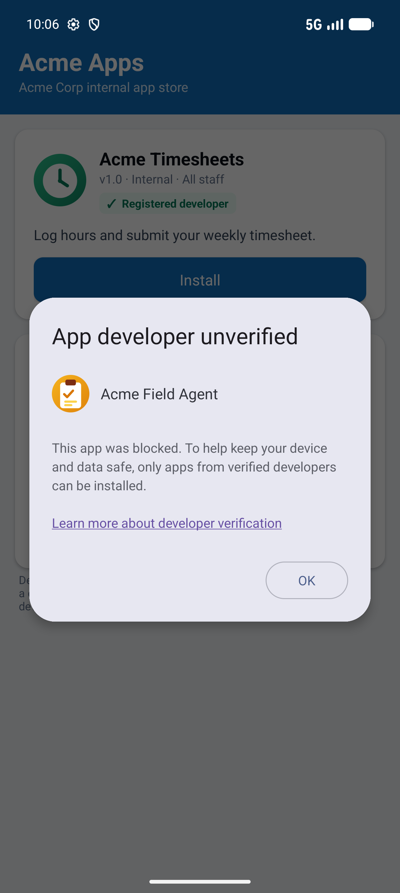
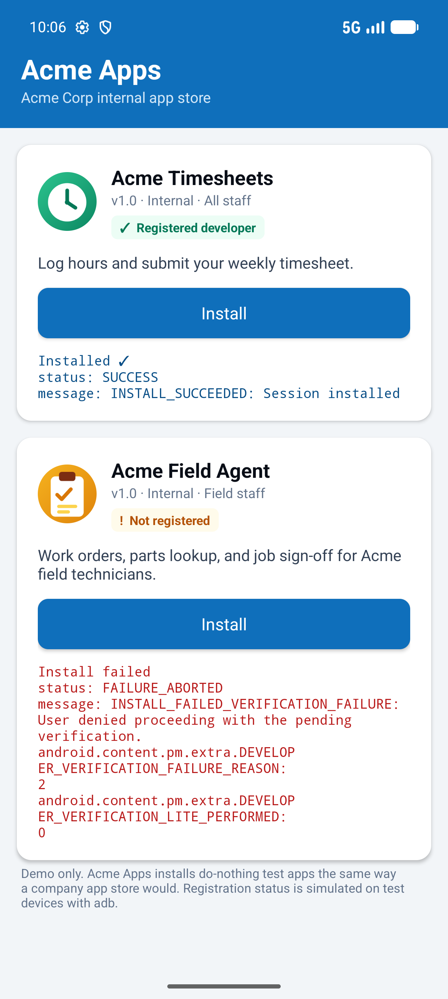

# Android developer verification demo

See what **Android developer verification** does to apps installed outside Google Play, using a fake company app store, **Acme Apps**, on an emulator.

| | |
| :-- | :-- |
|  |  |
| **Acme Field Agent** (not registered) is blocked: *"App developer unverified."* | **Same store, two results.** Acme Timesheets (registered) installs; Field Agent fails. |

Starting September 30, 2026 in Brazil, Indonesia, Singapore, and Thailand, and globally in 2027, apps on Play Protect certified Android devices must come from a registered developer to install, even when they never touch Google Play. This repo lets you see that today, from anywhere.

**Key point:** verification checks the app being installed, not the store installing it. **Registering your store doesn't register the apps it installs.**

## What's in here

| App | Package | Role |
| :-- | :-- | :-- |
| **Acme Apps** | `com.mattintech.acme.store` | A stand-in company app store. Installs apps with the `PackageInstaller` session API, like a real in-house or third-party store. |
| **Acme Timesheets** | `com.mattintech.acme.timesheets` | Do-nothing app, simulated as **registered** (verification forced to pass). |
| **Acme Field Agent** | `com.mattintech.acme.fieldagent` | Do-nothing app, simulated as **not registered** (verification forced to reject). |

Prebuilt APKs are in [`apks/`](apks/). They're signed with an Android debug key and contain no network code or data collection.

## Run it

You need `adb` and an **Android emulator image with Google Play, Android 16 QPR2 / Android 17 or later**.

```bash
./demo.sh setup -s emulator-5554
```

That installs Acme Apps (with `adb install`, which is exempt from verification, like an admin sideloading the store), forces the results below, and opens the store:

```bash
adb shell pm set-developer-verification-result com.mattintech.acme.timesheets 3 1   # policy closed, result pass
adb shell pm set-developer-verification-result com.mattintech.acme.fieldagent 3 2   # policy closed, result reject
```

Then tap **Install** on each app. Field Agent is also copied to `Downloads`, so you can try installing it from the Files app.

```bash
./demo.sh reset -s emulator-5554   # uninstall the two apps and re-apply the forced results
./demo.sh clean -s emulator-5554   # clear the forced results and remove everything
```

## What we found

- **Emulator (Android 17, Google Play):** works. Field Agent shows the real *"App developer unverified"* dialog, followed by a generic *"Can't install app: There's a problem with the app file"*. The store receives `INSTALL_FAILED_VERIFICATION_FAILURE` with `android.content.pm.extra.DEVELOPER_VERIFICATION_FAILURE_REASON = 2`.
- **Retail Samsung phone in Canada (Android 16, One UI 8.5):** the test command is accepted but ignored. Google's verifier reports `Pass(reason=FORCED_BACKPORT)` and the install goes through. Use an emulator to see the block.
- **Don't confuse it with Play Protect.** On the retail phone, installing the APK from the Files app triggered Play Protect's older "unknown app" scan. That's a different, existing feature.
- **`adb install` is exempt.** To see the block, install the way a user would: a store app, a download link, or the Files app.

## Build from source

No Gradle needed. With the Android SDK installed (`ANDROID_HOME` or `~/Library/Android/sdk`):

```bash
./build.sh   # writes out/acme-store.apk, out/acme-timesheets.apk, out/acme-fieldagent.apk
```

`demo.sh` uses `out/` if it exists, otherwise `apks/`.

## Learn more

- [Android developer verification](https://developer.android.com/developer-verification) (Google)
- [Developer verification guides](https://developer.android.com/developer-verification/guides): which console to use, and where it's in effect
- [Developer verification for private apps](https://support.google.com/work/android/answer/17266330?hl=en) (Android Enterprise Help)
- [Android 16 QPR2 Beta 2](https://android-developers.googleblog.com/2025/09/android-16-qpr2-beta-2-is-here.html): introduces the `set-developer-verification-result` test command

---

Made by Matt Hills ([mattintech.com](https://mattintech.com)). Not affiliated with Google or Samsung. "Acme" is a placeholder company. This is a demo, not a security tool.
